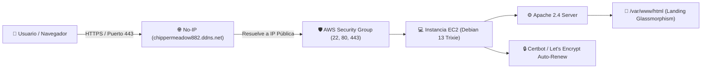

# 🚀 Guía Definitiva: Servidor Web Apache en AWS EC2, Dominio DDNS y SSL con Certbot

Bienvenido a la guía completa de configuración, despliegue y mantenimiento de tu servidor web en **Amazon Web Services (AWS)** con **Apache**, dominio personalizado y cifrado **HTTPS** mediante **Let's Encrypt / Certbot**.

---

> [!TIP]
> ### ⚡ Acelerador HTTP Varnish Integrado
> ¿Has añadido o quieres desplegar **Varnish Cache** como proxy inverso delante de Apache?
> 
> 👉 **[🚀 Pulsa aquí para abrir la Guía Completa de Varnish Cache (`varnish.md`)](file:///home/2asird/varnish.md)**
> 
> *Aprende cómo configurar Varnish en el puerto `80` para servir contenido ultra-rápido desde la memoria RAM mientras Apache atiende en el puerto interno `8080`.*
---

## 🗺️ Mapa de Arquitectura del Sistema



---

## 🔑 1. Conexión Segura por SSH mediante Clave Asimétrica (.pem)

AWS utiliza autenticación por clave pública/privada en lugar de contraseñas tradicionales para blindar el acceso a las instancias.

### 🛡️ Permisos requeridos para la clave privada
El cliente SSH exige que la clave privada no tenga permisos de lectura para otros usuarios del sistema local. Si los permisos son demasiado abiertos, SSH rechazará la conexión por seguridad (`UNPROTECTED PRIVATE KEY FILE`).

```bash
# Otorgar permisos exclusivos de lectura al propietario (tú)
chmod 400 ~/Descargas/ClaveMontano.pem
```

### 💻 Comando de conexión remota
```bash
ssh -i ~/Descargas/ClaveMontano.pem admin@<IP_PUBLICA_O_DNS_AWS>
```
* **Usuario:** `admin` (usuario por defecto en imágenes oficiales de Debian en AWS).
* **Parámetro `-i`:** Especifica la ruta absoluta o relativa hacia el archivo `.pem`.

---

## ⚙️ 2. Servidor Web Apache y Despliegue de la Landing Page

### 📦 Verificación e instalación de Apache
En distribuciones basadas en Debian:

```bash
sudo apt update
sudo apt install -y apache2
sudo systemctl enable apache2
sudo systemctl status apache2
```

### 🎨 Despliegue de la página web estética
La raíz de documentos por defecto en Apache es `/var/www/html`.

1. **Copia de seguridad del archivo por defecto:**
   ```bash
   sudo cp /var/www/html/index.html /var/www/html/index.html.debian.bak
   ```
2. **Características de la landing page desplegada:**
   * **Estética Dark & Glassmorphism:** Fondo moderno con degradados ambientales flotantes (*ambient glows*), cuadrícula geométrica suave y tarjetas translúcidas con desenfoque de fondo (`backdrop-filter: blur()`).
   * **Tipografía moderna:** Integración de fuentes Google Fonts (*Plus Jakarta Sans* y *JetBrains Mono*).
   * **Panel de telemetría:** Visualización en vivo de la IP pública, versión del servidor web, distribución del kernel y tipo de cifrado.
   * **Simulador de terminal:** Ventana de consola interactiva con comandos de inspección del servicio.
   * **Medidor de latencia en tiempo real:** Botón interactivo que calcula los milisegundos de tiempo de ida y vuelta (RTT) entre el navegador y el centro de datos de AWS en Virginia (us-east-1).
3. **Ajuste de permisos para el servidor web:**
   ```bash
   sudo chown www-data:www-data /var/www/html/index.html
   sudo chmod 644 /var/www/html/index.html
   ```

---

## 🌐 3. Asignación de Nombre de Dominio Gratuito (No-IP DDNS)

Para no depender de recordar direcciones IP numéricas complejas, se vinculó el dominio dinámico gratuito:
👉 **`chippermeadow882.ddns.net`**

### 📝 Configuración del VirtualHost en Apache
Para que Apache responda específicamente por ese nombre de host, se creó su archivo de configuración:

```bash
sudo nano /etc/apache2/sites-available/chippermeadow882.ddns.net.conf
```

Contenido del archivo:
```apache
<VirtualHost *:80>
    ServerName chippermeadow882.ddns.net
    ServerAdmin admin@chippermeadow882.ddns.net
    DocumentRoot /var/www/html

    ErrorLog ${APACHE_LOG_DIR}/chippermeadow882_error.log
    CustomLog ${APACHE_LOG_DIR}/chippermeadow882_access.log combined
</VirtualHost>
```

Habilitación del sitio y recarga:
```bash
sudo a2ensite chippermeadow882.ddns.net.conf
sudo systemctl reload apache2
```

---

## 🔒 4. Cifrado SSL y Certificado HTTPS con Certbot

Certbot automatiza la emisión, validación e instalación de certificados SSL gratuitos emitidos por la autoridad certificadora **Let's Encrypt**.

### 📥 Instalación de herramientas
```bash
sudo apt update
sudo apt install -y certbot python3-certbot-apache
```

### 🛡️ Obtención del certificado y redirección HTTPS automática
```bash
sudo certbot --apache -d chippermeadow882.ddns.net
```

> [!NOTE]
> **¿Qué realiza Certbot en este paso?**
> 1. Realiza el reto **ACME HTTP-01** (crea una ruta temporal en el servidor para que Let's Encrypt compruebe que el dominio apunta al servidor real).
> 2. Genera las claves criptográficas y guarda el certificado en `/etc/letsencrypt/live/chippermeadow882.ddns.net/`.
> 3. Crea automáticamente el archivo SSL `/etc/apache2/sites-available/chippermeadow882.ddns.net-le-ssl.conf` en el puerto `443`.
> 4. Configura la redirección forzada de **HTTP a HTTPS (código 301)** para garantizar que nadie navegue sin cifrar.
> 5. Habilita un temporizador en systemd (`certbot.timer`) para renovar el certificado antes de sus 90 días de caducidad.

---

## 🛠️ Problemas Encontrados y Cómo se Resolvieron

A lo largo de la configuración surgieron situaciones técnicas reales. A continuación se detalla cada una y su solución:

### ⚠️ Problema 1: No-IP apuntaba a la IP de tu router de casa (`80.31.44.195`)
* **Causa:** Al dar de alta un host en No-IP desde tu navegador, el portal auto-detecta la conexión a internet desde la que estás navegando y le asigna esa IP automáticamente por defecto.
* **Consecuencia:** Al intentar pedir el certificado SSL, Certbot fallaba porque Let's Encrypt intentaba validar el dominio conectándose a tu router residencial en lugar de a la máquina de AWS.
* **Solución:**
  1. Entrar a [noip.com](https://www.noip.com/) -> **Dynamic DNS** -> **No-IP Hostnames**.
  2. Modificar el campo **IP / Target** colocando manualmente la IP pública de la instancia EC2.
  3. Esperar 1-2 minutos a que el cambio se propague en los servidores DNS mundiales.

---

### ⚠️ Problema 2: Conflicto de prioridad en los VirtualHosts de Apache
* **Causa:** Apache lee los archivos de configuración en orden alfabético. El archivo `000-default.conf` se cargaba antes que `chippermeadow882.ddns.net.conf`. Al no tener un `ServerName` explícito, `000-default.conf` capturaba todas las peticiones del puerto 80 e impedía la redirección limpia hacia HTTPS.
* **Solución:**
  Deshabilitar el VirtualHost por defecto y recargar Apache para que el sitio específico tome el control absoluto:
  ```bash
  sudo a2dissite 000-default.conf
  sudo systemctl reload apache2
  ```

---

### ⚠️ Problema 3: "No me sale el candado de página segura en Google Chrome"
* **Causa:**
  1. **Rediseño de Google Chrome:** En las versiones actuales de Chrome, **Google retiró el dibujo tradicional del candado 🔒** para evitar una falsa sensación de seguridad ante páginas de phishing, reemplazándolo por el icono de **controles / ajustes (`🎛️`)**.
  2. **Caché previa del navegador:** Si visitaste la web antes de activar SSL, el navegador almacena la versión previa sin cifrar en su memoria temporal.
  3. **Acceso por IP:** Acceder mediante `https://54.x.x.x` genera advertencia de seguridad porque los certificados SSL van firmados a nombre del dominio (`chippermeadow882.ddns.net`), no de la dirección IP numérica.
* **Solución:**
  * Al pulsar el icono de ajustes (`🎛️`) a la izquierda de la URL, el navegador confirma: **"La conexión es segura"** y muestra el certificado válido de Let's Encrypt.
  * Acceder siempre mediante el nombre de dominio en una pestaña de **Incógnito** o forzar refresco con `Ctrl + F5`.

---

### ⚠️ Problema 4: La máquina dejó de responder días después (*Connection Timed Out*)
* **Causa:** En AWS EC2, las instancias que no tienen contratada una *Elastic IP* utilizan una **IP pública dinámica**. Cada vez que la instancia se detiene (*Stop*) y se vuelve a encender (*Start*), AWS libera la IP antigua y le asigna una IP pública completamente nueva (en este caso cambió de `98.88.23.170` a `54.172.162.111`).
* **Consecuencia:** El dominio en No-IP seguía apuntando a la IP antigua que ya no te pertenecía.
* **Solución:**
  1. Comprobar la nueva IP asignada en la consola de AWS EC2.
  2. Conectar por SSH a la nueva IP.
  3. Actualizar la IP en el panel de No-IP con la nueva dirección (`54.172.162.111`).

---

## 🔮 Problemas Potenciales Futuros y Cómo Prevenirlos

Aquí tienes los fallos más habituales que podrían presentarse en el futuro y la forma de resolverlos:

### 1. La IP vuelve a cambiar al apagar la máquina
> [!TIP]
> **Solución Definitiva (Elastic IP en AWS):**
> Para no tener que actualizar No-IP manualmente cada vez que reinicias la máquina:
> 1. Ve a la consola de **AWS EC2**.
> 2. En el menú lateral izquierdo: **Red y seguridad (Network & Security) -> Direcciones IP elásticas (Elastic IPs)**.
> 3. Haz clic en **Asignar dirección IP elástica (Allocate Elastic IP)**.
> 4. Selecciónala, pulsa en **Acciones -> Asociar dirección IP elástica (Associate Elastic IP)** y elígela para tu instancia EC2.
> *(Mientras la máquina esté encendida y asociada, la IP elástica es 100% gratuita y fija para siempre).*

---

### 2. Caducidad mensual de la cuenta gratuita de No-IP
> [!WARNING]
> Las cuentas gratuitas de No-IP exigen que **cada 30 días confirmes tu dominio** mediante un correo que te envían automáticamente. Si no haces clic en el enlace del correo, el dominio se suspende temporalmente y la web dejará de cargar.

---

### 3. Fallo en la renovación automática de Certbot
El certificado caduca cada 90 días. Certbot lo renueva automáticamente, pero podría fallar si:
* El puerto **80 (HTTP)** está cerrado en el Security Group de AWS (Let's Encrypt necesita el puerto 80 para validar el dominio).
* La IP de la máquina cambió y no coincide con el dominio en No-IP.

**Cómo comprobar la renovación manual o forzar un test:**
```bash
sudo certbot renew --dry-run
```

---

### 4. Reglas del Security Group de AWS bloqueadas
Si en algún momento no carga la página ni conecta por SSH:
* Revisa en AWS: **EC2 -> Instancias -> Tu Instancia -> Pestaña Seguridad -> Grupos de seguridad (Security Groups)**.
* Asegúrate de tener estas 3 reglas de entrada (*Inbound Rules*):

| Tipo | Protocolo | Puerto | Origen | Descripción |
| :--- | :--- | :--- | :--- | :--- |
| **SSH** | TCP | `22` | `0.0.0.0/0` (o tu IP) | Acceso a terminal remota |
| **HTTP** | TCP | `80` | `0.0.0.0/0` | Acceso web y validación Certbot |
| **HTTPS**| TCP | `443` | `0.0.0.0/0` | Acceso web seguro con candado |

---

## 🧰 Chuleta Rápida de Comandos Útiles

```bash
# Estado del servidor web Apache
sudo systemctl status apache2
sudo systemctl restart apache2
sudo systemctl reload apache2

# Comprobar la sintaxis de configuración de Apache
sudo apache2ctl configtest

# Ver los VirtualHosts activos
sudo apache2ctl -S

# Estado y comprobación de certificados SSL
sudo certbot certificates
sudo certbot renew --dry-run

# Ver registros de errores en tiempo real
sudo tail -f /var/log/apache2/error.log
sudo tail -f /var/log/apache2/chippermeadow882_error.log
```
