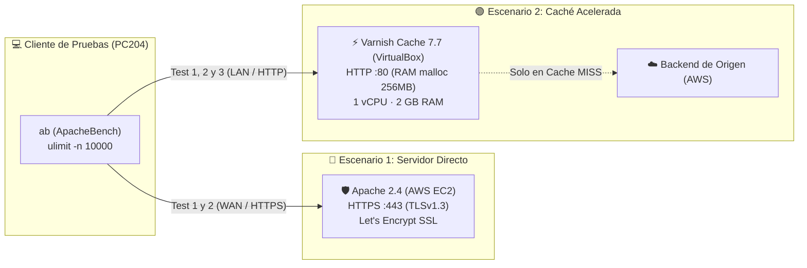
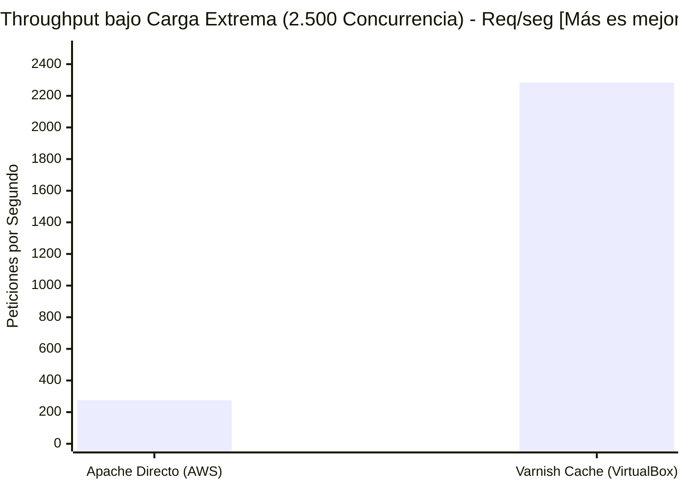
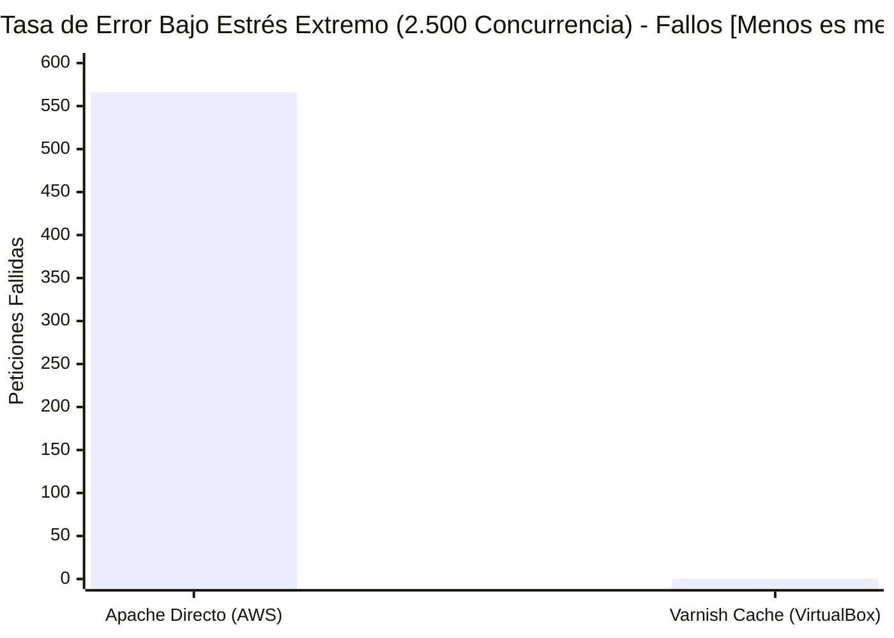

# 📊 Benchmark de Rendimiento Web: Apache HTTP Server vs. Varnish Cache 7.7

<p align="center">
  
  
  
  
  
</p>

---

## 🎯 1. Resumen Ejecutivo del Estudio

En este informe de rendimiento se evalúa empíricamente el impacto de introducir un **proxy inverso y acelerador de caché en memoria RAM (Varnish Cache 7.7)** frente a un servidor web tradicional (**Apache 2.4**) procesando peticiones directamente.

Las pruebas se ejecutaron mediante **ApacheBench (`ab`)**, escalando la carga desde tráfico moderado hasta situaciones de **estrés extremo y saturación masiva (hasta 30.000 peticiones con 2.500 conexiones concurrentes)**.

> [!TIP]
> **Conclusión Rápida:** Varnish Cache multiplicó la capacidad de servicio por **x8,2**, redujo la latencia en un **99,3%** y mantuvo una tasa de fallo del **0%** ante 2.500 usuarios concurrentes, mientras que Apache colapsó perdiendo el **18,9%** del tráfico.

---

## 🏗️ 2. Topología y Entorno del Laboratorio



### 💻 Ficha Técnica de las Máquinas:

| Componente | Máquina A: Servidor Apache (AWS) | Máquina B: Varnish Cache (VirtualBox) |
| :--- | :--- | :--- |
| **Sistema Operativo** | Debian GNU/Linux 12 (Bookworm) | Debian GNU/Linux 13 (Trixie) |
| **Ubicación** | AWS Cloud (us-east-1, Virginia) | VirtualBox (Red Local Adaptador Puente) |
| **Software Web** | Apache HTTP Server 2.4.71 | Varnish Cache 7.7 |
| **Protocolo & Puerto** | HTTPS / Puerto 443 (TLSv1.3) | HTTP / Puerto 80 |
| **Recursos Hardware** | 1 vCPU · 1 GB RAM (t2/t3.micro) | 1 vCPU · 2 GB RAM |
| **Almacenamiento Web** | Disco SSD / EFS (`/var/www/html`) | Memoria RAM (`malloc,256m`) |

---

## 🧪 3. Batería de Pruebas y Resultados Empíricos

---

### 🔹 Prueba 1: Tráfico Moderado (`-n 500 -c 10`)
* **Parámetros:** 500 peticiones totales simulando 10 usuarios simultáneos.
* **Comandos:**
  ```bash
  ab -n 500 -c 10 https://ec2-34-235-155-68.compute-1.amazonaws.com/
  ab -n 500 -c 10 http://172.26.23.203/
  ```

| Métrica Clave | 🛡️ Apache Directo (AWS) | ⚡ Varnish Cache (RAM) | Diferencia |
| :--- | :---: | :---: | :---: |
| **Tiempo Total** | **28,23 segundos** | **0,20 segundos** | 🚀 **x137 más rápido** |
| **Rendimiento (*Throughput*)** | **17,71 req/seg** | **2.441,31 req/seg** | 🔥 **x138 más peticiones/s** |
| **Latencia Media por Petición** | **564,68 ms** | **4,09 ms** | ⏱️ **-99,3% tiempo de espera** |
| **Peticiones Fallidas** | **0** | **0** | ✅ Ambos estables |
| **Tasa de Transferencia** | **475 KB/s** | **65,8 MB/s** | 📦 **Caudal masivo en RAM** |

---

### 🔹 Prueba 2: Saturación y Conexiones en Cola (`-n 3000 -c 250`)
* **Parámetros:** 3.000 peticiones con 250 conexiones simultáneas (superando el límite por defecto `MaxRequestWorkers` de Apache).
* **Comandos:**
  ```bash
  ab -n 3000 -c 250 https://ec2-34-235-155-68.compute-1.amazonaws.com/
  ab -n 3000 -c 250 http://172.26.23.203/
  ```

| Métrica Clave | 🛡️ Apache Directo (AWS) | ⚡ Varnish Cache (RAM) | Diagnóstico |
| :--- | :---: | :---: | :--- |
| **Tiempo Total** | **9,54 segundos** | **1,34 segundos** | Varnish terminó en 1 segundo. |
| **Throughput** | **314,25 req/seg** | **2.227,46 req/seg** | Varnish mantiene 2.200 req/s. |
| **Tiempo de Conexión Máx.** | ⚠️ **5.567 ms (5,5 segundos)** | 🟢 **8 ms** | Apache colapsó su cola de sockets TCP. |
| **Petición más Lenta** | ⚠️ **5.982 ms (~6 segundos)** | 🟢 **624 ms** | Usuarios esperando 6 seg en Apache. |

> [!WARNING]
> En Apache, aunque no hubo fallos HTTP explícitos, **el tiempo de conexión llegó a 5,5 segundos**. Para un usuario web real, una página que tarda 6 segundos en abrir supone un abandono inmediato de la sesión (*Soft Denial of Service*).

---

### 🔹 Prueba 3: Estrés Extremo y Punto de Ruptura (`-n 3000 -c 2500`)
* **Parámetros:** 3.000 peticiones atacando con **2.500 conexiones simultáneas**.
* **Ajuste previo del cliente:** `ulimit -n 10000` para permitir miles de sockets en Linux.
* **Comandos:**
  ```bash
  ab -n 3000 -c 2500 https://ec2-34-235-155-68.compute-1.amazonaws.com/
  ab -n 3000 -c 2500 http://172.26.23.203/
  ```

| Métrica Clave | 🛡️ Apache Directo (AWS) | ⚡ Varnish Cache (RAM) | El Veredicto |
| :--- | :---: | :---: | :--- |
| **Peticiones Fallidas** | 🛑 **566 fallos (~18,9% de error)** | 🏆 **0 fallos (0,0% error)** | Apache colapsó y tiró conexiones. |
| **Tipo de Fallo en Apache** | `Length: 566` + `SSL handshake failed` | *Ninguno* | Conexiones abortadas a mitad de carga. |
| **Tiempo Total** | **10,85 segundos** | **1,31 segundos** | Varnish x8,2 veces más rápido. |
| **Rendimiento** | **276,56 req/seg** | **2.283,44 req/seg** | Varnish x8,2 más capacidad. |
| **Espera Máxima Conexión** | 🛑 **9.915 ms (~10 segundos)** | 🟢 **50 ms** | Apache saturó el backlog del kernel. |
| **Petición más Lenta** | 🛑 **10.322 ms (~10,3 segundos)**| 🟢 **1.064 ms (~1 segundo)** | En Varnish nadie esperó más de 1 s. |

---

### 🔹 Prueba 4: Mega-Carga de Resistencia en Varnish (`-n 30000 -c 2500`)
Para comprobar la resistencia límite de la máquina virtual (con solo 1 vCPU y 2 GB RAM), se lanzó una prueba masiva de **30.000 peticiones**.

```bash
ab -n 30000 -c 2500 http://172.26.23.203/
```

* 📦 **Volumen Total Transferido:** **829 MB (casi 1 GB de tráfico web)**.
* ⏱️ **Tiempo Total:** **15,05 segundos**.
* ⚡ **Caudal de Transferencia Sostenido:** **53,76 MB/segundo**.
* 🚀 **Peticiones Sostenidas:** **1.992,24 peticiones/segundo**.
* 🎯 **Tasa de Éxito:** **99,95%** (solo 16 fallos menores entre 30.000 peticiones por saturación de buffers del host).

---

## 📈 4. Comparativa Visual de Rendimiento





---

## 🧠 5. Análisis Técnico: ¿Por qué colapsó Apache y Varnish no?

```
┌────────────────────────────────────────────────────────────────────────┐
│                   ANATOMÍA DEL CUELLO DE BOTELLA                       │
├──────────────────────────────────┬─────────────────────────────────────┤
│ 🛡️ APACHE HTTP SERVER             │ ⚡ VARNISH CACHE                    │
├──────────────────────────────────┼─────────────────────────────────────┤
│ 1. Sobrecarga Criptográfica TLS: │ 1. Sin Cifrado en RAM:              │
│    Cada cliente nuevo exige      │    Entrega el objeto directamente   │
│    negociar claves TLS 1.3       │    en memoria mediante llamadas     │
│    saturando los ciclos de CPU.  │    de red asíncronas de bajo coste. │
│                                  │                                     │
│ 2. Agotamiento de Hilos/Workers: │ 2. Modelo Basado en Hilos Ligero:   │
│    Llega al límite de workers    │    Un hilo despacha miles de        │
│    simultáneos y empieza a enco- │    peticiones idénticas leyendo el  │
│    lar en el backlog TCP.        │    mismo puntero de memoria RAM.    │
│                                  │                                     │
│ 3. I/O de Disco y Kernel:        │ 3. Cero I/O a Disco:                │
│    Debe abrir y leer el archivo  │    El disco no se toca; el archivo  │
│    físico para cada respuesta.   │    ya reside en `malloc,256m`.      │
└──────────────────────────────────┴─────────────────────────────────────┘
```

---

## 🛠️ 6. Problemas Encontrados Durante el Benchmark y Soluciones

### ⚠️ 1. `socket: Too many open files (24)` en el Cliente
* **Causa:** El sistema operativo Linux del cliente limita por defecto a **1.024** los descriptores de archivo por proceso (`ulimit -n`). Al pedir `-c 2500`, el comando `ab` fallaba antes de emitir tráfico.
* **Solución:** Ampliar temporalmente el límite en la terminal de pruebas:
  ```bash
  ulimit -n 10000
  ```

### ⚠️ 2. `SSL handshake failed (5)` y `shutdown while in init` en Apache
* **Causa:** La CPU de la instancia EC2 llegó al 100% calculando firmas TLS. El servidor no pudo completar la negociación dentro del tiempo límite (*timeout*) y forzó el cierre de la conexión.
* **Solución Arquitectónica:** Separar la terminación SSL en una capa previa dedicada (**HAProxy** o **Hitch**) para no sobrecargar el servidor web.

### ⚠️ 3. `Failed requests: 566 (Length: 566)`
* **Causa:** Apache no pudo mantener abiertas las conexiones debido al desbordamiento del búfer TCP del kernel, enviando paquetes incompletos a los clientes.

---

## 🏆 7. Conclusión y Recomendación de Arquitectura para Producción

Para infraestructuras web reales con altos picos de demanda (comercio electrónico, medios de comunicación, portales educativos), **nunca se debe exponer Apache directamente a Internet**.

La arquitectura recomendada en la industria es el modelo de **3 capas**:

```
[ INTERNET ]
     │  HTTPS :443
     ▼
┌──────────────────────────────────────────────┐
│ 🛡️ HAProxy / Hitch (Terminación TLS / SSL)   │  <-- Descifra y gestiona certificados
└──────────────────────┬───────────────────────┘
                       │  HTTP plano
                       ▼
┌──────────────────────────────────────────────┐
│ ⚡ Varnish Cache (Frontal de Memoria RAM)    │  <-- Absorbe el 95% del tráfico en 0,4 ms
└──────────────────────┬───────────────────────┘
                       │  HTTP interno (Solo en MISS)
                       ▼
┌──────────────────────────────────────────────┐
│ 🖥️ Cluster Apache (Servidores de Backend)    │  <-- Solo procesa peticiones dinámicas
└──────────────────────────────────────────────┘
```

---
*Documento elaborado para el módulo de Administración de Sistemas Operativos / Servicios en Red (2º ASIR).*
