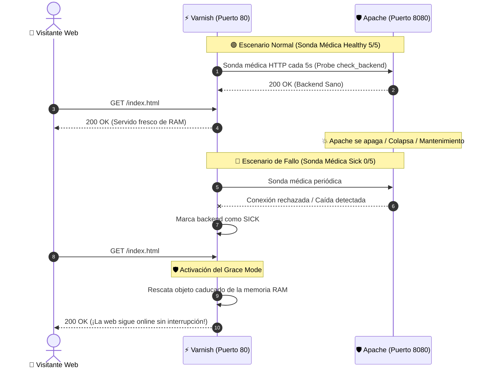
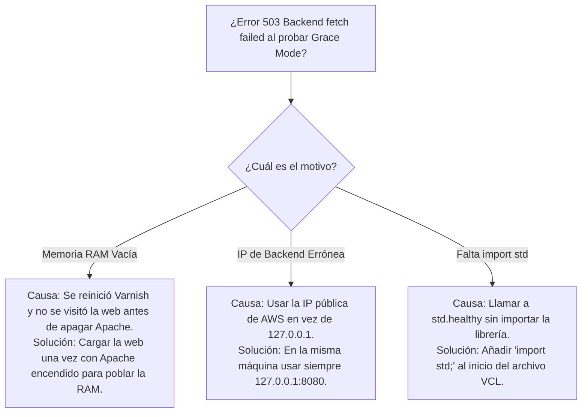

# 🛡️ Alta Disponibilidad Web: Grace Mode y Health Checks en Varnish Cache 7.7

<p align="center">
  
  
  
  
</p>

---

## 📌 1. ¿Qué es el Grace Mode y por qué es crítico en Producción?

En una arquitectura web tradicional, si el servidor web de origen (**Apache**) se cae, sufre un error de código o se reinicia por mantenimiento, los usuarios reciben de inmediato un error crítico:  
🛑 **`HTTP 503 Backend fetch failed`** o **`502 Bad Gateway`**.

El **Grace Mode (*Modo de Gracia*)** es una funcionalidad avanzada de **Varnish Cache** que transforma un proxy de aceleración en un **escudo de Alta Disponibilidad**:

> [!IMPORTANT]
> **El Principio del Grace Mode:**  
> Permite a Varnish conservar en memoria RAM objetos web caducados (*stale content*). Si el backend de Apache deja de responder o está caído, Varnish **rescata la versión guardada en memoria y la sirve con un código `200 OK`**, garantizando que el usuario nunca perciba la caída del servicio.

---

## 🔄 2. Arquitectura y Ciclo de Vida: Escenario Normal vs. Catástrofe



---

## 🛠️ 3. Configuración Paso a Paso en `/etc/varnish/default.vcl`

Para habilitar la detección de salud y el modo de gracia, se configuran cuatro bloques fundamentales en el archivo VCL:

```bash
sudo nano /etc/varnish/default.vcl
```

### 📄 Código VCL Completo y Comentado:

```vcl
vcl 4.1;

# 1. Importamos la librería estándar para acceder a funciones de salud (std.healthy)
import std;

# 2. Sonda Médica (Health Check): Monitoriza continuamente a Apache
probe check_backend {
    .url = "/";          # Ruta que consultará la sonda
    .timeout = 2s;       # Tiempo máximo de espera por respuesta
    .interval = 5s;      # Cada cuántos segundos envía un chequeo
    .window = 5;         # Guarda el histórico de las últimas 5 comprobaciones
    .threshold = 3;      # Si al menos 3 de 5 responden bien, se considera SANO (Healthy)
}

# 3. Definición del Backend enlazado a la sonda
backend default {
    .host = "127.0.0.1";        # IP local donde escucha Apache
    .port = "8080";             # Puerto interno de Apache
    .probe = check_backend;     # Conexión con la sonda médica
}

# 4. Recepción de Peticiones: Activación del rescate en memoria
sub vcl_recv {
    # Si la sonda médica detecta que Apache está caído (!std.healthy),
    # autorizamos servir contenido en memoria de hasta 1 hora de antigüedad
    if (!std.healthy(req.backend_hint)) {
        set req.grace = 1h;
    }
}

# 5. Gestión de Tiempos en la Respuesta del Backend
sub vcl_backend_response {
    # Vida normal en caché del recurso fresco: 2 minutos
    set beresp.ttl = 2m;

    # Tiempo de gracia: mantiene el objeto en RAM durante 1 HORA adicional
    # listo para ser rescatado si Apache muere
    set beresp.grace = 1h;
}

sub vcl_deliver {
    # Cabeceras informativas para depuración
    if (obj.grace > 0s) {
        set resp.http.X-Grace-Status = "ENABLED";
    }
}
```

---

## 🚀 4. Aplicación de Cambios y Verificación de Sintaxis

Antes de reiniciar el servicio, se verifica que el compilador de VCL no detecte errores sintácticos:

```bash
# 1. Test de compilación VCL
sudo varnishd -C -f /etc/varnish/default.vcl > /dev/null && echo "✅ Sintaxis VCL Correcta"

# 2. Reiniciar Varnish para aplicar la sonda y el Grace Mode
sudo systemctl restart varnish
```

---

## 🧪 5. Demostración Práctica del Laboratorio

### 🔍 Fase 1: Estado Inicial con Apache Encendido

Consultamos el estado de la sonda médica a través de la CLI de administración de Varnish:

```bash
sudo varnishadm backend.list
```

**Salida Obtenida:**
```text
Backend name    Admin    Probe    Health     Last change
boot.default    probe    5/5      healthy    Wed, 25 Nov 2026 07:49:01 GMT
```
* **`5/5 healthy`**: Las últimas 5 comprobaciones respondieron satisfactoriamente. Apache está sano.

Cargamos la página por primera vez para poblar la memoria RAM:
```bash
curl -I http://127.0.0.1/
```
```http
HTTP/1.1 200 OK
Server: Apache/2.4.71 (Debian)
X-Varnish: 2
Age: 0
Via: 1.1 ip-172-31-19-251 (Varnish/7.7)
```

---

### 💥 Fase 2: Simulación de Desastre (Apagado Provocado de Apache)

Detenemos deliberadamente el servicio web de Apache:

```bash
sudo systemctl stop apache2
```

Verificamos que Apache está completamente apagado:
```bash
sudo systemctl status apache2
# Output: Active: inactive (dead)
```

Esperamos unos segundos y volvemos a consultar la sonda médica:
```bash
sudo varnishadm backend.list
```

**Salida Obtenida:**
```text
Backend name    Admin    Probe    Health    Last change
boot.default    probe    0/5      sick      Wed, 25 Nov 2026 07:49:10 GMT
```
* **`0/5 sick`**: La sonda ha detectado inmediatamente la caída de Apache y marca el backend como enfermo.

---

### 🛡️ Fase 3: La Prueba del Grace Mode

Con **Apache completamente muerto**, solicitamos de nuevo la página web:

```bash
curl -I http://127.0.0.1/
```

**Salida Obtenida:**
```http
HTTP/1.1 200 OK
Date: Wed, 25 Nov 2026 07:49:04 GMT
Server: Apache/2.4.71 (Debian)
X-Varnish: 5 3
Age: 13
Via: 1.1 ip-172-31-19-251 (Varnish/7.7)
Connection: keep-alive
```

> [!TIP]
> **Análisis de la Evidencia:**
> * **`HTTP/1.1 200 OK`**: El cliente recibe la web intacta sin errores 502/503.
> * **`X-Varnish: 5 3`**: El segundo identificador (`3`) demuestra que Varnish reutilizó el objeto guardado en RAM.
> * **`Age: 13`**: El contenido fue despachado desde la memoria donde llevaba 13 segundos retenido.

---

## ⚠️ 6. Problemas Frecuentes y Lecciones Aprendidas (Troubleshooting)



### 1️⃣ Error 503 por Memoria RAM Vacía
* **Problema:** Al reiniciar Varnish (`systemctl restart varnish`), **toda la memoria RAM se borra**. Si se apaga Apache antes de haber realizado al menos una petición para guardar la web en caché, Varnish no tiene ningún objeto en reserva para el Grace Mode y devuelve `503`.
* **Solución:** Siempre se debe visitar la web con Apache encendido al menos una vez tras reiniciar Varnish.

### 2️⃣ Error de Conexión en AWS (NAT Hairpinning)
* **Problema:** Configurar `.host = "IP_PUBLICA_AWS";` en una máquina de AWS EC2 para hablar con su propio Apache local. Las instancias de AWS no pueden enrutar tráfico hacia su propia IP elástica externa de forma directa (*hairpinning*), y además el puerto 8080 está protegido por el *Security Group*.
* **Solución:** Si Varnish y Apache conviven en la misma instancia, el backend debe definirse obligatoriamente como **`127.0.0.1`**.

---

## 🏆 7. Conclusión y Valor Empresarial

| Sin Grace Mode | Con Grace Mode (Varnish 7.7) |
| :--- | :--- |
| ❌ Caída inmediata de la web si Apache se apaga. | ✅ La web permanece 100% online y operativa. |
| ❌ Pérdida de ventas, registros y visitas. | ✅ Cero impacto para los usuarios durante incidencias. |
| ❌ Mantenimientos programados requieren cortar servicio. | ✅ **Despliegues con Cero Tiempo de Inactividad (*Zero-Downtime*)**. |

---
*Práctica de Servicios en Red y Alta Disponibilidad — 2º ASIR.*
