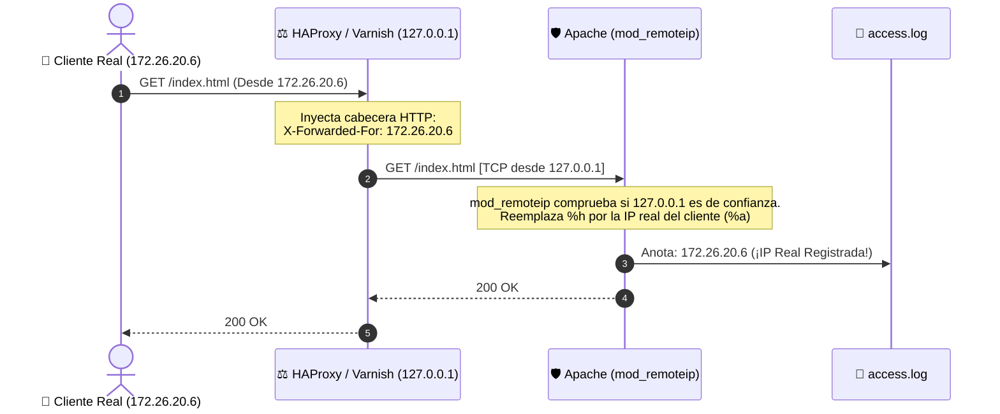

# 🕵️‍♂️ Auditoría de Seguridad: Restaurar la IP Real en Logs de Apache con `mod_remoteip`

<p align="center">
  
  
  
  
</p>

---

## 📌 1. El Problema Clásico: El "Ocultamiento de IPs" tras un Proxy

Cuando se interpone un balanceador de carga o proxy inverso (**HAProxy**, **Varnish**, **Nginx** o un balanceador de AWS) delante de un servidor web **Apache**, la conexión TCP directa ya no se establece con el usuario final de Internet, sino entre el proxy y Apache.

```
Visitante Real (172.26.20.6) ──▶ [ HAProxy / Varnish ] ──▶ [ Apache :8080 ]
                                  (127.0.0.1 o IP Proxy)        ▲
                                                                │
                                    Apache cree que quien visita es el Proxy
```

### ⚠️ El grave peligro para la seguridad y la administración:
1. **Pérdida total de trazabilidad:** En los registros de acceso (`access.log`), **todas las peticiones aparecen registradas como `127.0.0.1`** o con la IP interna del proxy.
2. **Inutilidad de herramientas de defensa (Fail2ban, WAF):** Si intentas bloquear por fuerza bruta a un atacante, ¡bloquearías la IP de tu propio balanceador, tirando el servicio a todos los usuarios legítimos!
3. **Métricas falsas en GoAccess / Analíticas:** En las herramientas de monitorización, todas las visitas del mundo se contabilizan como si fueran un único usuario navegando desde localhost.

---

## 🔄 2. La Solución Arquitectónica: `X-Forwarded-For` + `mod_remoteip`



---

## 🛠️ 3. Configuración Paso a Paso

---

### 🔹 Paso 1: Configurar el Proxy / Balanceador para Enviar la IP

El proxy debe insertar la cabecera HTTP estándar **`X-Forwarded-For`** con la dirección IP de origen del cliente.

#### En HAProxy (`/etc/haproxy/haproxy.cfg`):
En el bloque `frontend`, añade la directiva `option forwardfor`:
```haproxy
frontend http_in
    bind *:80
    mode http
    option forwardfor # <-- Inyecta la cabecera X-Forwarded-For
    default_backend apache_servers
```

#### En Varnish Cache (`/etc/varnish/default.vcl`):
Varnish añade automáticamente `X-Forwarded-For` por defecto en su VCL integrado (*builtin.vcl*).

---

### 🔹 Paso 2: Habilitar el módulo `remoteip` en Apache

En el servidor Apache, activa el módulo oficial de resolución de IPs remotas:

```bash
sudo a2enmod remoteip
```

---

### 🔹 Paso 3: Definir la Lista de Proxies Internos de Confianza

Por seguridad, Apache solo debe fiarse de la cabecera `X-Forwarded-For` si la petición proviene de un proxy autorizado por ti (para evitar que atacantes falsifiquen cabeceras mediante *IP Spoofing*).

Crea el archivo de configuración:
```bash
sudo nano /etc/apache2/conf-available/remoteip.conf
```

Añade las siguientes directivas:
```apache
# Le dice a Apache qué cabecera contiene la IP real
RemoteIPHeader X-Forwarded-For

# Define qué IPs son proxies de confianza autorizados
RemoteIPInternalProxy 127.0.0.1
RemoteIPInternalProxy ::1
# Si el proxy está en otra máquina en red local:
# RemoteIPInternalProxy 172.26.23.203
```

Activa la configuración:
```bash
sudo a2enconf remoteip
```

---

### 🔹 Paso 4: Actualizar el Formato de Logs de Apache (`%h` ➔ `%a`)

Edita el archivo de configuración principal de Apache:
```bash
sudo nano /etc/apache2/apache2.conf
```

Localiza las directivas `LogFormat` (alrededor de la línea 200) y sustituye el parámetro **`%h`** (Remote Hostname del socket TCP) por **`%a`** (Client IP real resuelta por `mod_remoteip`):

```apache
# Reemplazar %h por %a en los formatos principales:
LogFormat "%v:%p %a %l %u %t \"%r\" %>s %O \"%{Referer}i\" \"%{User-Agent}i\"" vhost_combined
LogFormat "%a %l %u %t \"%r\" %>s %O \"%{Referer}i\" \"%{User-Agent}i\"" combined
```

---

### 🔹 Paso 5: Validar Sintaxis y Reiniciar Apache

```bash
sudo apache2ctl configtest
# Debe devolver: Syntax OK

sudo systemctl restart apache2
```

---

## 🧪 4. Verificación y Evidencias Reales de Laboratorio

Para contrastar el comportamiento, monitorizamos en directo el fichero de registro del VirtualHost:

```bash
sudo tail -f /var/log/apache2/chippermeadow882_access.log
```

### 📊 Comparativa de Salida en Registro:

| Escenario | Línea Obtenida en `/var/log/apache2/...access.log` | Diagnóstico |
| :--- | :--- | :--- |
| **❌ ANTES de `mod_remoteip`** | `127.0.0.1 - - [27/Nov/2026:10:29:48] "GET /test" 404 ...` | Apache solo ve al balanceador local. La IP del cliente se pierde. |
| **🩺 Health Check de HAProxy** | `127.0.0.1 - - [27/Nov/2026:10:31:07] "GET / HTTP/1.0" 200 ...` | Conexión interna legítima de monitorización de HAProxy. |
| **✅ DESPUÉS de `mod_remoteip`** | `172.26.20.6 - - [27/Nov/2026:10:31:08] "GET /test" 404 ...` | **¡ÉXITO!** Se registra la IP física real del cliente (`PC204`). |

---

## 🌐 5. Impacto en Paneles de Analítica (GoAccess)

Al implementar `mod_remoteip`:
* **En el Dashboard de GoAccess (`/stats.html`):**  
  La sección **«Visitantes Únicos»** y **«IPs de Host»** deja de agrupar todo en `127.0.0.1` y desglosa cada conexión con la IP pública/privada real de cada equipo de la red.
* **Geolocalización real:** Permite a GoAccess ubicar geográficamente el origen del tráfico de los visitantes.

---

## ⚠️ 6. Buenas Prácticas de Seguridad

> [!CAUTION]
> **Diferencia entre `RemoteIPInternalProxy` y `RemoteIPTrustedProxy`:**
> * Utiliza **`RemoteIPInternalProxy`** para tus proxies y balanceadores locales dentro de tu red privada o en la misma máquina (`127.0.0.1`). Esta directiva descarta la IP del proxy de las cabeceras finales y no la expone.
> * Utiliza **`RemoteIPTrustedProxy`** únicamente si recibes tráfico a través de intermediarios externos de confianza como Cloudflare o CDNs públicas.

---

## 🏆 7. Conclusión

La configuración de `mod_remoteip` es un **requisito indispensable de nivel profesional** en cualquier arquitectura desacoplada en capas (HAProxy / Varnish + Apache):
* Restaura la visibilidad total en análisis forenses y auditorías de seguridad.
* Permite la integración correcta de sistemas IDS/IPS y cortafuegos dinámicos (*Fail2ban*).
* Aporta veracidad y precisión a los paneles de analítica en tiempo real como GoAccess.

---
*Práctica de Seguridad en Servidores Web y Arquitectura de Redes — 2º ASIR.*
