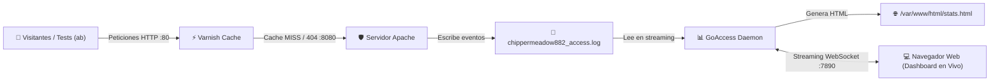

# 📊 Monitorización Web en Tiempo Real: GoAccess Dashboard para Apache y Varnish

<p align="center">
  
  
  
  
</p>

---

## 📌 1. ¿Qué es GoAccess y para qué sirve?

**GoAccess** es un analizador de registros (*logs*) de servidores web en tiempo real, interactivo y de código abierto. Está programado íntegramente en lenguaje **C**, lo que le otorga una velocidad de procesamiento ultrarrápida y un consumo mínimo de recursos de CPU y memoria RAM.

Su objetivo principal es transformar los ficheros de texto plano de Apache (`access.log`) en **dashboards visuales de alto impacto**, tanto en la terminal como a través de un navegador web moderno con gráficos que se actualizan automáticamente mediante **WebSockets**.

---

## 🏗️ 2. Arquitectura de Flujo de Datos



---

## 🛠️ 3. Instalación y Puesta en Marcha

### 📦 Paso 1: Instalación del paquete
En Debian / Ubuntu:
```bash
sudo apt update
sudo apt install -y goaccess
```

---

## 🖥️ 4. Las Dos Formas de Visualización

### 🔹 Modo 1: Terminal Interactiva (ncurses)
Ideal para administración remota rápida vía SSH sin interfaz gráfica:

```bash
sudo goaccess /var/log/apache2/chippermeadow882_access.log -c
```

1. Selecciona con la barra espaciadora la primera opción: **`[x] NCSA Combined Log Format`**.
2. Pulsa `Enter`.
3. Navega por las diferentes métricas con las teclas `0` al `9` y sal con `q`.

---

### 🔹 Modo 2: Panel Web HTML en Tiempo Real *(Recomendado para Producción)* 🌟

Genera una página HTML interactiva y levanta un demonio en segundo plano que sincroniza las estadísticas en directo vía WebSocket (puerto `7890`):

```bash
sudo goaccess /var/log/apache2/chippermeadow882_access.log \
  -o /var/www/html/stats.html \
  --log-format=COMBINED \
  --real-time-html \
  --daemon
```

* **`-o /var/www/html/stats.html`**: Destino del informe dentro del DocumentRoot del servidor web.
* **`--log-format=COMBINED`**: Formato estándar de registros de Apache.
* **`--real-time-html`**: Habilita el servidor WebSocket interno para refresco instantáneo sin recargar la página.
* **`--daemon`**: Mantiene el proceso activo en segundo plano de forma desatendida.

👉 **Acceso desde el navegador:**  
`http://IP_DEL_SERVIDOR/stats.html` *(ej. `http://172.26.23.203/stats.html`)*

---

## ⚡ 5. Integración Crítica con Varnish Cache

En un entorno donde Varnish convive con Apache, se producen dos peculiaridades técnicas esenciales:

### 1️⃣ Evitar que Varnish cachee el panel de estadísticas (`stats.html`)
Si Varnish guarda `stats.html` en su memoria RAM, el navegador siempre verá una versión estática congelada en el tiempo.

Para solucionarlo, se añade una regla de paso directo en `/etc/varnish/default.vcl`:

```vcl
sub vcl_recv {
    # No cachear el dashboard de GoAccess para que siempre cargue en vivo
    if (req.url ~ "^/stats.html") {
        return (pass);
    }
}
```
Se aplica con:
```bash
sudo systemctl reload varnish
```

### 2️⃣ El comportamiento de la caché sobre los Logs
* **En un Cache HIT:** Varnish responde desde la RAM. Apache **no recibe la petición y no escribe en su log**.
* **En un Cache MISS o Error 404:** La petición llega a Apache, se anota en el log y GoAccess la procesa de inmediato.

---

## 🧪 6. Pruebas y Verificación en Vivo

### 🔴 Prueba A: Detección Masiva de Errores 404
Ejecuta este bucle para enviar peticiones a rutas inexistentes:
```bash
for ruta in admin login contacto panel archivo-secreto fotos; do
    curl -s -o /dev/null http://172.26.23.203/$ruta
    echo "404 enviado a: /$ruta"
    sleep 1
done
```
* **En GoAccess:** Verás cómo la sección **«404 Not Found URLs»** añade las rutas en tiempo real.

### 📈 Prueba B: Simulación de Picos de Tráfico (Bypass de Caché)
```bash
for i in {1..10}; do
    curl -s -o /dev/null -H "Cache-Control: no-cache" "http://172.26.23.203/?visita=$i"
    sleep 1
done
```
* **En GoAccess:** Los contadores de **«Total Requests»** y **«Visitantes Únicos»** aumentan en vivo.

---

## ⚠️ 7. Problemas Frecuentes y Soluciones (Troubleshooting)

| Problema / Síntoma | Causa Raíz | Solución |
| :--- | :--- | :--- |
| **GoAccess no muestra datos ni se actualiza** | Se está leyendo `/var/log/apache2/access.log` (vacío, 0 bytes) en lugar del log específico del VirtualHost. | Apuntar a `/var/log/apache2/chippermeadow882_access.log` donde Apache escribe activamente. |
| **Todas las visitas salen con la IP `127.0.0.1`** | Apache registra la IP del socket del proxy (HAProxy o Varnish) en vez del cliente real. | Activar `mod_remoteip` en Apache. 👉 **[Ver Guía de mod_remoteip](./logs_ip_real_mod_remoteip.md)**. |
| **La página `stats.html` siempre muestra lo mismo** | Varnish ha guardado `stats.html` en memoria RAM. | Añadir `if (req.url ~ "^/stats.html") { return (pass); }` en `vcl_recv` de Varnish. |
| **El WebSocket no conecta (punto rojo en el panel)** | El puerto `7890` de WebSocket está bloqueado por el firewall o Security Group. | Abrir el puerto `7890/TCP` en el firewall o comprobar con `ss -tulpn \| grep 7890`. |

---

## 🏆 8. Conclusión

La combinación de **Varnish Cache + Apache + GoAccess** ofrece una solución integral de nivel corporativo:
* **Aceleración:** Varnish absorbe el 95% del tráfico en memoria RAM a velocidad extrema.
* **Seguridad y Auditoría:** Apache gestiona el backend y registra las incidencias.
* **Visibilidad:** GoAccess proporciona métricas visuales en tiempo real para monitorizar ataques, errores y tráfico sin añadir latencia al servidor.

---
*Práctica de Administración de Sistemas y Servicios Web — 2º ASIR.*
