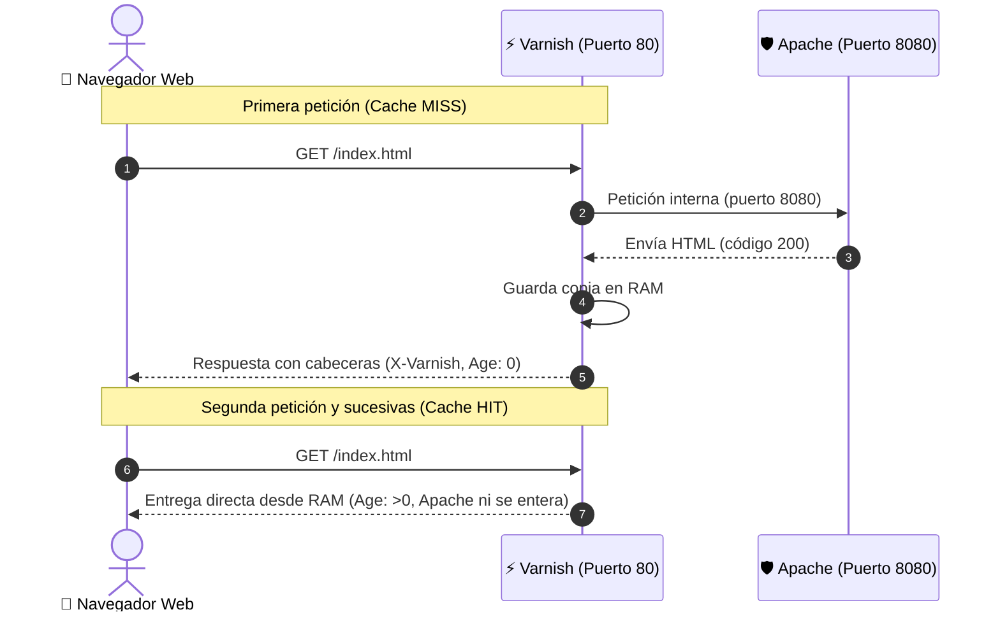
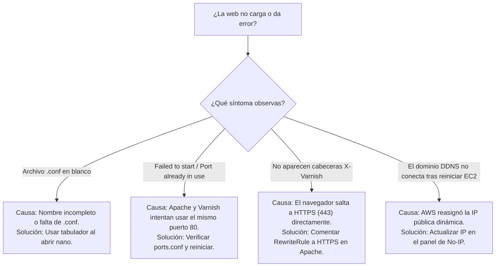

# 🚀 Guía de Despliegue: Varnish Cache + Apache HTTP Server en AWS EC2

> **Entorno de Despliegue:** Debian GNU/Linux 12 (Bookworm) · Apache 2.4 · Varnish 7.7 · AWS EC2  
> **Objetivo:** Configurar Varnish como proxy inverso y acelerador HTTP en el puerto 80, delegando el backend a Apache en el puerto 8080.

---

## 📌 1. ¿Qué es Varnish Cache y para qué sirve?

**Varnish Cache** es un acelerador de aplicaciones web de alto rendimiento que opera como un **proxy inverso de caché HTTP**. Se ubica entre los clientes web (navegadores) y el servidor web de origen (**Apache**).

Su misión fundamental es almacenar en la **memoria RAM** las respuestas a peticiones HTTP. Cuando varios usuarios solicitan el mismo recurso, Varnish lo entrega al instante sin que Apache tenga que leer del disco ni procesar la petición.

### 🔄 Flujo de Peticiones



---

## 🏗️ 2. Arquitectura de Puertos: Antes vs. Después

| Componente | Antes de Varnish | Con Varnish Integrado | Rol en la Arquitectura |
| :--- | :---: | :---: | :--- |
| **Varnish Cache** | *No instalado* | **Puerto 80** (Público) | Portero / Front-end / Acelerador RAM |
| **Apache HTTP** | **Puerto 80** | **Puerto 8080** (Interno) | Servidor de Origen / Back-end |
| **Apache SSL** | Puerto 443 | Puerto 443 | Tráfico Seguro HTTPS |

---

## 🛠️ 3. Despliegue Paso a Paso

### 📦 Paso 1: Instalación de Varnish

Instala el paquete oficial y sus dependencias desde los repositorios de la distribución:

```bash
sudo apt update
sudo apt install -y varnish
```

> [!NOTE]
> La instalación crea el servicio `varnish.service` y el archivo de configuración de reglas VCL en `/etc/varnish/default.vcl`.

---

### 🔀 Paso 2: Reubicar Apache al Puerto 8080

Para que Varnish pueda tomar el puerto web principal (`80`), debemos liberar a Apache de ese puerto.

#### 1. Modificar los puertos de escucha globales
Edita el archivo de configuración de puertos de Apache:
```bash
sudo nano /etc/apache2/ports.conf
```
Localiza la directiva `Listen 80` y modifícala:
```apache
# Sustituir Listen 80 por:
Listen 8080

<IfModule ssl_module>
    Listen 443
</IfModule>
```

#### 2. Actualizar el VirtualHost del sitio
Edita el archivo de configuración de tu sitio web:
```bash
sudo nano /etc/apache2/sites-available/chippermeadow882.ddns.net.conf
```
Ajusta la directiva de apertura y comenta la redirección obligatoria a HTTPS:
```apache
<VirtualHost *:8080>
    ServerName chippermeadow882.ddns.net
    ServerAdmin admin@chippermeadow882.ddns.net
    DocumentRoot /var/www/html

    ErrorLog ${APACHE_LOG_DIR}/chippermeadow882_error.log
    CustomLog ${APACHE_LOG_DIR}/chippermeadow882_access.log combined

    # Comentamos temporalmente la redirección a HTTPS para que las
    # peticiones HTTP pasen por Varnish en lugar de saltar al puerto 443
    #RewriteEngine on
    #RewriteCond %{SERVER_NAME} =chippermeadow882.ddns.net
    #RewriteRule ^ https://%{SERVER_NAME}%{REQUEST_URI} [END,NE,R=permanent]
</VirtualHost>
```

#### 3. Reiniciar Apache y verificar
```bash
sudo systemctl restart apache2
sudo ss -tulpn | grep 8080
```
> [!TIP]
> Deberás ver una línea que confirme que `apache2` está en estado `LISTEN` en el puerto `8080`.

---

### 🎯 Paso 3: Configurar el Backend en Varnish

Varnish necesita saber a qué dirección y puerto enviar las peticiones cuando no disponga del recurso en memoria.

Edita la configuración VCL:
```bash
sudo nano /etc/varnish/default.vcl
```

Verifica o ajusta el bloque `backend default`:
```vcl
vcl 4.1;

# Definición del backend hacia Apache
backend default {
    .host = "127.0.0.1";
    .port = "8080";
}
```

---

### 🌐 Paso 4: Configurar Varnish para Escuchar en el Puerto 80

Por defecto, en Debian Varnish viene asignado al puerto `6081`. Para actuar como servidor web frontal debe escuchar en el puerto `80`.

#### 1. Editar la unidad de servicio systemd
```bash
sudo nano /lib/systemd/system/varnish.service
```

Localiza el parámetro `ExecStart` y sustituye `-a :6081` por `-a :80`:
```ini
ExecStart=/usr/sbin/varnishd \
          -a :80 \
          -a 127.0.0.1:8443,PROXY \
          -p feature=+http2 \
          -f /etc/varnish/default.vcl \
          -s malloc,256m
```

#### 2. Recargar systemd y reiniciar Varnish
```bash
sudo systemctl daemon-reload
sudo systemctl restart varnish
```

#### 3. Comprobar sockets en escucha
```bash
sudo ss -tulpn | grep -E 'varnish|apache'
```
Debe mostrarse:
* `varnishd` / `cache-main` en el puerto `*:80`.
* `apache2` en el puerto `*:8080` y `*:443`.

---

## 🧪 4. Pruebas de Funcionamiento y Verificación de Caché

### 🔍 Inspección de Cabeceras HTTP con `curl`

Ejecuta dos peticiones consecutivas contra el servidor:

```bash
# Primera petición
curl -I http://34.235.155.68/

# Segunda petición (1 segundo después)
curl -I http://34.235.155.68/
```

#### ¿Cómo interpretar la salida?

```http
HTTP/1.1 200 OK
Date: Wed, 18 Nov 2026 08:05:52 GMT
Server: Apache/2.4.71 (Debian)
Via: 1.1 ip-172-31-19-251 (Varnish/7.7)
X-Varnish: 32770 3
Age: 1
```

| Cabecera | Significado | Evidencia de Caché |
| :--- | :--- | :--- |
| **`Via`** | Informa el proxy intermediario | Certifica que la respuesta transitó por **Varnish 7.7**. |
| **`Age`** | Segundos que el objeto lleva en RAM | `0` = Generado en el momento (MISS). `>0` = Entregado de RAM (HIT). |
| **`X-Varnish`** | IDs de petición asignados por Varnish | **Un solo ID:** Petición que consultó a Apache. <br>**Dos IDs (`32770 3`):** El 1º es la petición actual, el 2º es el objeto en caché recuperado. |

---

### 📊 Monitorización en Tiempo Real: `varnishstat`

Abre la consola de estadísticas interactiva de Varnish:
```bash
sudo varnishstat
```

Observa los siguientes contadores clave:
* **`MAIN.client_req`**: Total de peticiones recibidas por Varnish.
* **`MAIN.cache_hit`**: Número de peticiones servidas directamente desde la memoria RAM.
* **`MAIN.cache_miss`**: Peticiones que requirieron acudir a Apache.

---

## ⚠️ 5. Problemas Frecuentes (Troubleshooting) y Soluciones



### 1️⃣ El archivo de configuración aparece vacío al editar
* **Causa:** Al teclear nombres largos como `chippermeadow882.ddns.net.conf`, cualquier errata o haber omitido la extensión `.conf` hace que `nano` cree un nuevo archivo en blanco en lugar de abrir el existente.
* **Solución:** Acceder al directorio y autocompletar con la tecla `Tab`:
  ```bash
  cd /etc/apache2/sites-available/
  sudo nano chip[TAB]
  ```

---

### 2️⃣ Conflicto de puertos: `Address already in use`
* **Causa:** Intentar iniciar Varnish en el puerto 80 antes de haber cambiado Apache al puerto 8080 o antes de reiniciar Apache. Dos servicios no pueden enlazar el mismo socket simultáneamente.
* **Solución:**
  1. Revisar `/etc/apache2/ports.conf` asegurando que no quede ningún `Listen 80`.
  2. Reiniciar Apache: `sudo systemctl restart apache2`.
  3. Arrancar Varnish: `sudo systemctl restart varnish`.

---

### 3️⃣ Varnish parece ignorarse (No hay cabeceras `X-Varnish`)
* **Causa:** Si el VirtualHost de Apache conserva reglas activas de redirección a HTTPS (`RewriteRule ^ https://...`), cuando el cliente entra por el puerto 80, Apache le ordena saltar a `https://...` (puerto 443). El navegador conectará entonces al puerto 443 de Apache, puenteando a Varnish.
* **Solución:** En el archivo del VirtualHost HTTP, comentar con almohadilla (`#`) las líneas `RewriteEngine on`, `RewriteCond` y `RewriteRule`.

---

### 4️⃣ Varnish no aplica el puerto 80 tras modificar `varnish.service`
* **Causa:** Los archivos de servicio de `systemd` se cargan en memoria al arrancar el sistema. Si se modifica `/lib/systemd/system/varnish.service`, systemd seguirá ejecutando la versión en memoria con el puerto antiguo (`6081`).
* **Solución:**
  ```bash
  sudo systemctl daemon-reload
  sudo systemctl restart varnish
  ```

---

### 5️⃣ Desconexión tras reiniciar la máquina EC2 en AWS
* **Causa:** A menos que la instancia cuente con una dirección IP elástica (Elastic IP), AWS asigna una nueva IP pública dinámica cada vez que la máquina se apaga y se vuelve a encender. Esto desincroniza los servicios de DNS dinámico como No-IP.
* **Solución:**
  1. Obtener la IP pública actual en AWS (`curl -s https://ifconfig.me`).
  2. Actualizar el registro `A` en el panel de No-IP o configurar `ddclient` en la instancia para auto-actualizarse.

---

> [!TIP]
> **Comando de comprobación rápida general:**
> ```bash
> sudo apache2ctl configtest && sudo varnishd -C -f /etc/varnish/default.vcl > /dev/null && echo "✅ Sintaxis de Apache y Varnish correcta"
> ```
